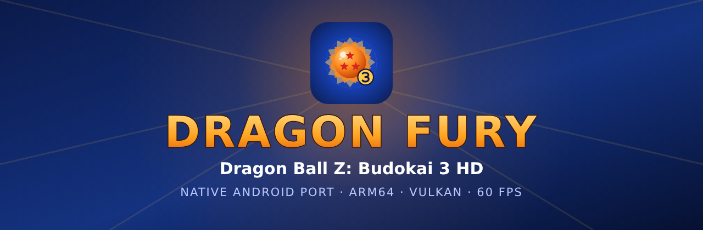

<a href="README.md">English</a> · <a href="README.pt-BR.md">Português (Brasil)</a> · <b>Español</b>

# Dragon Fury

**Dragon Fury** es un port nativo para Android de *Dragon Ball Z: Budokai 3 HD* (de la *Budokai HD
Collection* de Xbox 360). Parte de la recompilación para PC de
[novapowers0](https://github.com/novapowers0/DBZ-Budokai-3-HD-Collection) (ReXGlue SDK) y lleva el
juego a teléfonos y consolas portátiles ARM64, con launcher propio, controles táctiles, Tag Team,
online y una ruta de GPU reescrita para las GPU móviles.

> **No se incluye ningún archivo del juego.** Necesitas tu propia copia del juego (versión USA).

## Lo más destacado

- **60 FPS a la resolución nativa de 720p en un Snapdragon 865** (Retroid Pocket 5), con el driver
  de Qualcomm del sistema. Empezó en ~37 fps; la mejora vino de reescribir cómo se ejecuta el
  trabajo de la GPU de Xbox 360 en las GPU tiler móviles (ver [Rendimiento](#rendimiento)).
- Funciona con el **driver del sistema** en Adreno y Mali. **Turnip** también va bien (opcional).
- Modo **Tag Team** y Duelo **online** (1P vs 2P) de la versión de PC.
- Launcher con **mods**, **packs de texturas HD**, **trucos**, gestor de drivers, opciones de
  rendimiento por dispositivo, editor de controles táctiles y exportación de logs.
- Inglés, portugués (Brasil) y español — se elige automáticamente según el idioma del teléfono.

## Requisitos

| | |
|---|---|
| Android | 11 o superior, 64 bits (arm64-v8a) |
| GPU | Vulkan 1.1 — se recomienda Adreno 6xx o superior; Mali (Valhall, p. ej. G57/G610/G710) funciona |
| Almacenamiento | ~3 GB libres (el juego se copia a la app, ~2,5 GB) |
| Juego | *Dragon Ball Z: Budokai HD Collection* — copia **USA** de Xbox 360 |

### Dispositivos probados

| Dispositivo | SoC / GPU | Resultado |
|---|---|---|
| Retroid Pocket 5 | Snapdragon 865 / Adreno 650 | 60 FPS estables en combate (driver del sistema y Turnip) |
| AYN Odin 3 | Snapdragon 8 Elite | Funciona (primer dispositivo donde arrancó el port) |
| Anbernic RG Cube | Unisoc T770 / Mali-G57 | ~22–24 FPS en combate; usa el modo 30 FPS y desactiva los efectos |

Otros chips de la clase del Snapdragon 865 o superiores (Snapdragon 8 Gen 1/2/3, Dimensity 1100+,
Exynos recientes) deberían ir a velocidad completa o cerca. Se agradecen reportes.

## Instalación

1. Descarga el `DragonFury-*.apk` más reciente en [Releases](../../releases) e instálalo.
2. Copia el `.iso` de tu disco Budokai 3 HD Collection (USA) al dispositivo.
3. Abre Dragon Fury → **Importar .iso** → elige el archivo. Solo se extraen de la imagen el
   ejecutable de Budokai 3 y sus datos (unos 2,5 GB, unos minutos); el ejecutable se comprueba por
   SHA-256. Después puedes borrar el `.iso`.
   - ¿Ya extrajiste el disco? **Carpeta extraída** → elige la carpeta `DBZ3` (contiene
     `yae3_xenon.xex` y la carpeta `us/`).
4. Pulsa **Jugar**.

## Launcher

| Pestaña | Qué hace |
|---|---|
| **Inicio** | Animación de choque de ki, jugar, importar el juego (.iso o carpeta), enlaces de la comunidad (YouTube, Discord, GitHub, Ko-fi), atajos. |
| **Rendimiento** | Modo 30 FPS, resolución interna (1x/2x/3x), efectos del juego (bloom, profundidad de campo, FXAA), filtros de imagen (FSR 1, CAS, nitidez), proporción, consejos de rendimiento. |
| **Controles** | Controles táctiles (diseños para menús, combates y el mapa de Dragon Universe; editor en pantalla, opacidad, vibración) y mando físico (zona muerta, vibración). |
| **Mods** | Instalar mods desde `.zip` (mismo formato que la carpeta `mods/` de la versión de PC). |
| **Texturas** | Importar y gestionar packs de texturas HD. |
| **Trucos** | Desbloquear todos los personajes (se están investigando más trucos). |
| **Drivers** | Driver del sistema o Turnip; descarga drivers desde la app (Mr. Purple, StevenMXZ, K11MCH1) o importa un `.zip`. |
| **Ajustes** | Audio, idioma del juego, interruptores de Tag Team / Online / forma inicial, orientación, tema (Dragon Fury o Material You), idioma de la app, actualizaciones. |
| **Depuración** | Exportar registros, registro detallado, diagnóstico de rendimiento, opciones internas del renderizador, correcciones de Turnip para pruebas, `cvars.txt`. |
| **Acerca de** | Ficha del juego, el proyecto original (NovaPowers), este port, créditos y licencia. |

En el primer inicio la app muestra un aviso corto sobre drivers y GPU; se puede volver a abrir desde
**Rendimiento**.

## Rendimiento

El juego es ligero para un teléfono actual, pero emular la GPU de Xbox 360 (Xenos, con sus 10 MB
de EDRAM) en una GPU tiler móvil era el cuello de botella: cada "corte de pasada" obliga a la GPU a
escribir en memoria todo el color + profundidad de 1280x720 y a leerlo de vuelta. Este port:

- mantiene cada render target en su propia imagen, en lugar de copiar el contenido del EDRAM;
- escribe las copias de la pantalla directamente en la textura que lee el juego (sin pasar por la
  memoria emulada);
- especializa los shaders traducidos según el formato de textura;
- dibuja el `Clear()` del XDK (en Xbox 360, un rectángulo 4x MSAA de media anchura) directamente a 1x;
- saca las subidas de memoria de dentro de las pasadas y prepara antes las texturas copiadas;
- omite los dibujados de "restauración" y las copias que solo existían por el EDRAM de Xbox 360.

Resultado en el Snapdragon 865: ~37 → 60 FPS (tiempo de GPU por frame ~26 → ~14,5 ms). En el
Mali-G57: 13 → 22–24 FPS. El registro completo de mediciones está en
[`docs/ESTADO.md`](docs/ESTADO.md) y el método reutilizable en
[`docs/GUIA_PORT_XBOX360_ANDROID.md`](docs/GUIA_PORT_XBOX360_ANDROID.md) (en portugués).

### Consejos para GPU más débiles (Mali, Adreno 6xx por debajo del 865)

- **Rendimiento → Modo 30 FPS**: el juego sigue a velocidad completa y dibuja un frame de cada dos,
  mostrado a un ritmo constante de 30 FPS.
- **Rendimiento → Efectos del juego**: desactiva bloom, profundidad de campo y FXAA.
- Deja la resolución interna en **1x**.

## Drivers

El port se optimizó con el **driver de Qualcomm del sistema**: del Snapdragon 865 en adelante
funciona con el driver que trae el dispositivo. **Turnip** (driver de código abierto para Adreno)
también va bien ahora y puede gastar menos batería en algunos dispositivos; elígelo en **Drivers** si
quieres. Los dispositivos Mali usan el driver del sistema.

## Tag Team

Los combates por equipos de la versión de PC: **TAG TEAM** aparece en el menú principal. Arma tu
equipo y cambia de luchador durante el combate con **Back/Select** (el botón "cambiar" de los
controles táctiles). Se puede desactivar en **Ajustes**.

## Online (1P vs 2P)

1. Los dos jugadores necesitan **la misma versión del APK de Dragon Fury** (Android solo juega con
   Android; no se puede jugar contra la versión de PC) y los mismos mods.
2. En el menú **Duelo**, elige la quinta fila, **ONLINE**.
3. **Anfitrión:** pulsa **Crear partida**. Aparece un **código de sala** de 10 letras
   (`XXXXX-XXXXX`). **Invitado:** escribe el código (o la IP del anfitrión) y pulsa **Unirse**.
4. El anfitrión pulsa **Empezar**; elegid **1P vs 2P** — el anfitrión es el jugador 1.
5. Pulsa **X** en el menú Duelo para salir.

Sobre la red:
- En Android no hay apertura automática de puertos (UPnP). En la **misma red Wi-Fi** funciona
  directamente (usa la IP local del anfitrión). Por internet, el anfitrión debe abrir el **puerto UDP
  7777** en el router, o los dos usan una VPN como Tailscale/ZeroTier.
- Con datos móviles normalmente no se puede hospedar (NAT del operador).
- La partida va en lockstep: una conexión estable importa más que la velocidad. Pausar la app termina
  la sesión.

## Mods, texturas y trucos

- **Mods:** mismo formato que la versión de PC (una carpeta por mod). Los packs de personajes deben
  traer la carpeta `_roster` ya montada (el montador en Python no funciona en Android). Los mods de
  personajes necesitan la copia USA.
- **Texturas HD:** importa los packs en la pestaña **Texturas**.
- **Trucos:** "Desbloquear todos los personajes" (no toca tu partida guardada). Cápsulas, Zeni y
  escenarios están en ingeniería inversa.

## Compilar desde el código

El repositorio contiene el proyecto Android y los parches, no el juego ni el código generado.

1. Clona este repositorio en `~/AndroidStudioProjects/DBZ3-Android`.
2. Pon el ReXGlue SDK v0.10 en `external/rexglue-sdk-0.10` y el
   [proyecto original](https://github.com/novapowers0/DBZ-Budokai-3-HD-Collection) en
   `external/dbz3`, con `generated/` producido por el codegen de ReXGlue a partir de tu
   `yae3_xenon.xex`.
3. `bash tools/sync-upstream-overlay.sh && bash tools/apply-sdk-patches.sh`
4. `./gradlew assembleRelease`

Detalles en [`docs/ESTADO.md`](docs/ESTADO.md).

## Próximos pasos

- Más optimización para GPU Mali (shaders propios para los ~33 shaders del juego, renderizador nativo).
- Corregir el parpadeo negro ocasional en los menús en Mali.
- Más trucos (cápsulas, Zeni, escenarios) y parche widescreen.

## Créditos

- [novapowers0](https://github.com/novapowers0/DBZ-Budokai-3-HD-Collection) — recompilación para PC,
  Tag Team, online, mods.
- ReXGlue SDK y el proyecto [Xenia](https://xenia.jp) — runtime de la recompilación y emulación de la GPU.
- SDL, Vulkan, libadrenotools, Turnip/Mesa y quienes empaquetan los drivers (Mr. Purple, StevenMXZ, K11MCH1).
- Port para Android, launcher y trabajo de GPU móvil: **dfdx047**, con Claude (Anthropic).

## Aviso

Dragon Fury es un proyecto de fans, sin relación con Bandai Namco, Toei Animation ni Microsoft.
*Dragon Ball* es una marca de sus respectivos dueños. No se distribuye ningún dato del juego
protegido por derechos de autor; necesitas tener el juego.
